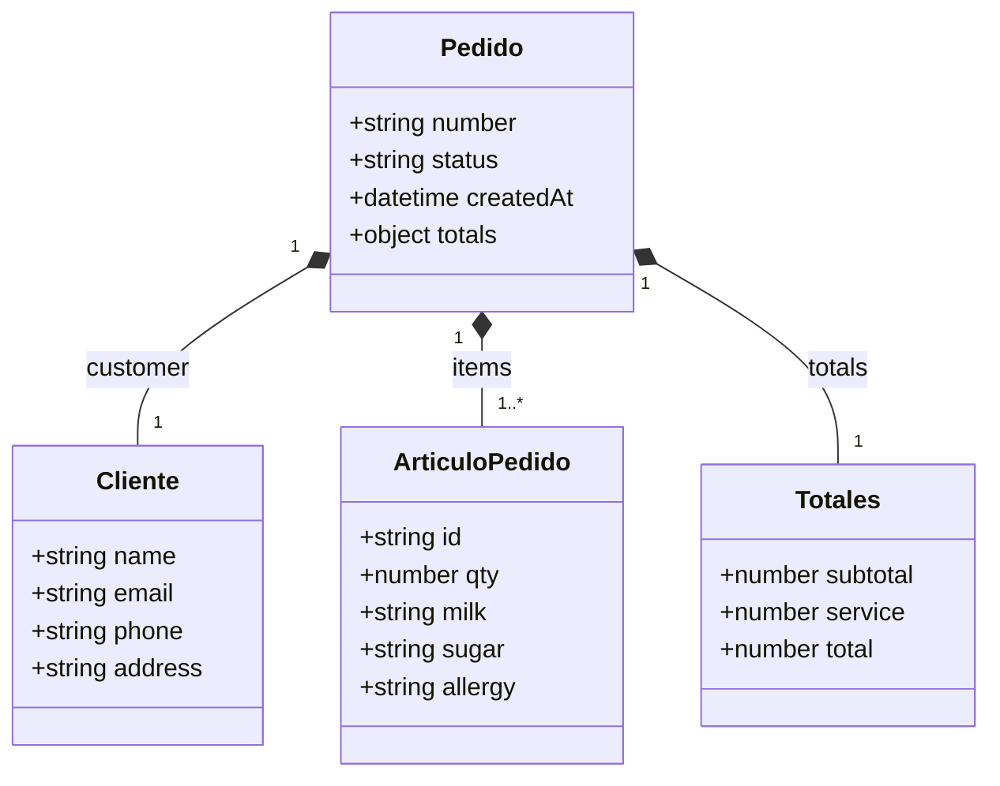

# Análisis de entidad, operaciones CRUD y seguridad

## 1. Descripción breve del sistema

La Bourboneria es una aplicación de cafetería que presenta un catálogo, permite preparar un carrito y confirmar pedidos. También incluye una página de cuenta con datos de contacto e historial y un panel que muestra pedidos y permite cambiar su estado. Es una aplicación cliente construida con React; no se identificaron API ni conexión a base de datos. El estado se conserva localmente en el navegador mediante `localStorage`.

## 2. Entidad principal: Pedido

Se selecciona **Pedido** porque representa el flujo de negocio principal: se construye a partir del carrito, contiene los artículos y datos de contacto del comprador, genera importes y transita por estados que se muestran en el panel. El objeto se crea en `src/App.jsx` (líneas 100–119) y sus artículos e importes se preparan con funciones de `src/utils/shop.js`.

Los tipos y restricciones que no tienen una definición formal en el código se indican como **inferidos** o **no especificados**. No existe un esquema de base de datos.

| Campo | Tipo de dato | Descripción | Obligatorio | Sensible |
|---|---|---|---|---|
| `number` | Cadena | Número visible del pedido, generado a partir de la hora actual. | Sí en el objeto creado; unicidad no especificada. | No por sí solo; puede vincularse con datos personales. |
| `status` | Cadena; valores de interfaz inferidos | Estado inicial `pendiente`; la interfaz contempla `preparacion`, `listo` y `entregado`. | Sí en el objeto creado. | No. |
| `customer.name` | Cadena | Nombre del cliente; usa un texto sustituto si no hay nombre guardado. | No especificado como requisito. | Sí: dato personal identificable. |
| `customer.email` | Cadena | Correo electrónico; usa un texto sustituto si no hay correo. | No especificado como requisito. | Sí: dato de contacto. |
| `customer.phone` | Cadena | Teléfono; usa un texto sustituto si no hay teléfono. | No especificado como requisito. | Sí: dato de contacto. |
| `customer.address` | Cadena | Dirección de entrega o referencia; usa un texto sustituto si no hay dirección. | No especificado como requisito. | Sí: dato de ubicación y contacto. |
| `items[]` | Arreglo de objetos | Productos y cantidades incluidos en el pedido. | Sí en el objeto creado; puede estar vacío si se manipula el estado fuera del flujo normal. | No generalmente; contiene opciones que pueden revelar preferencias. |
| `items[].id` | Cadena | Identificador del producto del catálogo. | Sí por construcción; validación del servidor no existe. | No. |
| `items[].qty` | Número | Cantidad de unidades del producto. | Sí por construcción; límites no especificados. | No. |
| `items[].milk` | Cadena | Preferencia de leche, cuando el producto la admite. | No; opcional según producto. | No generalmente. |
| `items[].sugar` | Cadena | Preferencia de azúcar, cuando el producto la admite. | No; opcional según producto. | No generalmente. |
| `items[].allergy` | Cadena | Nota de alergias o cuidados para ciertos productos. | No; opcional según producto. | **Potencialmente sí**: el texto podría contener información de salud. |
| `totals.subtotal` | Número | Importe de productos antes del servicio. | Sí por construcción; tipo inferido. | No. |
| `totals.service` | Número | Cargo de servicio calculado en el cliente. | Sí por construcción; tipo inferido. | No. |
| `totals.total` | Número | Subtotal más servicio. | Sí por construcción; tipo inferido. | No. |
| `createdAt` | Cadena ISO | Fecha y hora en que el navegador crea el pedido. | Sí por construcción. | No por sí sola; puede facilitar correlación. |

**Referencias:** creación del objeto en `src/App.jsx` (líneas 100–119); normalización de los artículos y cálculo de totales en `src/utils/shop.js` (líneas 62–69 y 88–97); catálogo con `id`, `name`, `category`, `price`, `image` y `description` en `src/data/products.js` (líneas 1–9 y estructura repetida para los demás productos).

El diagrama describe la estructura observada en el estado del cliente, no tablas ni relaciones persistidas en una base de datos.

## 3. Matriz CRUD y permisos

El proyecto **no implementa roles ni autenticación**. Las columnas “Permiso propuesto” presentan una distribución recomendada, no controles existentes. En la interfaz actual, cualquier persona que abra la aplicación puede navegar a sus páginas; React no es una barrera de autorización.

| Entidad o dato | Crear | Leer | Actualizar | Eliminar |
|---|---|---|---|---|
| Pedido | Cliente — interfaz disponible; solo local. | Cliente: su última confirmación; panel: pedidos guardados en ese navegador. Permiso real no controlado. | Personal autorizado — recomendado. Actualmente cualquiera en ese navegador puede cambiar el estado desde el panel. | Admin — recomendado, con registro/auditoría; no hay acción de borrado de pedidos en la interfaz. |
| Datos de contacto del perfil (`name`, `email`, `phone`, `address`) | Cliente — formulario local. | Usuario del mismo navegador/origen; no hay separación por cuenta. | Cliente — guardar cambios en el formulario local. | Cliente — botón “Limpiar Datos”; solo limpia el perfil local. |
| Artículos del carrito | Cliente — agrega productos del catálogo. | Usuario del mismo navegador/origen. | Cliente — cambia cantidad y opciones. | Cliente — quita al bajar la cantidad a cero o limpia el carrito. |
| Catálogo de productos | Admin — no implementado; catálogo fijo en código. | Visitantes — lectura del catálogo público. | Admin — no implementado. | Admin — no implementado. |
| Estado del pedido | Se inicializa como `pendiente` al confirmar. | Se muestra en la cuenta y el panel locales. | Personal autenticado — recomendado; hoy el botón del panel cambia estado sin autenticar. | No aplica como operación separada; eliminar el pedido no está implementado. |

### Estado real de las operaciones

- **Implementado en el navegador:** agregar artículos al carrito, ajustar cantidades y opciones, limpiar el carrito, guardar/limpiar el perfil, crear un pedido al confirmar y avanzar su estado desde el panel. La lógica está en `src/App.jsx` (líneas 73–150) y los controles de interfaz en `src/pages/CartPage.jsx` (líneas 23–40) y `src/pages/AdminPage.jsx` (líneas 19–23 y 52–69).
- **Persistencia simulada/local:** `ShopContext` lee y escribe carrito, pedidos, último pedido y perfil en `localStorage` (`src/context/ShopContext.jsx`, líneas 5–24). Esto persiste en el navegador del usuario, no constituye una base de datos compartida ni sincroniza con otros dispositivos.
- **Datos de demostración:** `buildPersonalHistory` genera pedidos de muestra a partir de los datos del perfil (`src/utils/shop.js`, líneas 113–151). No son transacciones verificadas.
- **No implementado:** API, base de datos, autenticación, roles, permisos por registro, cancelación/borrado de pedidos y operaciones administrativas del catálogo. El `package.json` solo declara React/React DOM como dependencias de aplicación y scripts de Vite (`package.json`, líneas 1–23); no se encontró código de llamadas HTTP o autenticación bajo `src/`.

## 4. Regla indispensable de seguridad

### Regla

**Solo personal autenticado y autorizado debe poder consultar los datos de contacto del pedido y modificar su estado; el cliente debe acceder únicamente a sus propios pedidos.**

### Importancia y estado actual

Los pedidos guardan nombre, correo, teléfono, dirección y potencialmente notas de alergias. El panel los muestra juntos (`src/pages/AdminPage.jsx`, líneas 52–66). A la vez, la ruta del panel se renderiza directamente desde `src/App.jsx` (líneas 156–165), sin una comprobación de identidad o rol. La acción `advanceOrder` modifica el estado del pedido en el estado compartido (`src/App.jsx`, líneas 148–150), y ese estado se guarda en `localStorage` (`src/context/ShopContext.jsx`, líneas 15–20).

Por tanto, **no hay autorización efectiva en la aplicación**. Como no existe backend ni datos centralizados, esto no demuestra que un atacante remoto pueda leer pedidos de otros clientes; el riesgo verificable es que cualquier persona con acceso al mismo navegador/origen pueda abrir el panel y cambiar los pedidos locales. Además, `localStorage` está disponible para JavaScript ejecutado en el mismo origen, por lo que no debe tratarse como almacén seguro para datos personales.

### Implementación recomendada al incorporar backend

Autenticar al usuario en el servidor y validar permisos en cada endpoint, no solo ocultar una ruta o botón en React. El servidor debe comprobar que el cliente sea propietario del pedido y que solo el rol de personal autorizado pueda cambiar su estado. Calcular y validar importes e identificadores en el servidor; minimizar los datos personales que se persisten y no guardar información sensible en `localStorage`. Si se usa sesión web, preferir cookies `HttpOnly`, `Secure` y `SameSite` con protección CSRF adecuada. La interfaz React solo debe reflejar la autorización confirmada por el servidor.

## 5. Duda técnica y respuesta

### Pregunta

**¿Qué impide que una persona no autorizada abra `/admin` y cambie a “entregado” el estado de un pedido?**

### Respuesta

En el código actual, nada lo impide dentro de la interfaz: la aplicación renderiza `AdminPage` cuando la ruta es `admin` (`src/App.jsx`, línea 164), y el botón llama a `onAdvance` sin verificar identidad ni rol (`src/pages/AdminPage.jsx`, línea 68). La función solo actualiza el arreglo local de pedidos (`src/App.jsx`, líneas 148–150). Esto es una **regla de autorización incompleta** y una **posible modificación no autorizada de los datos del navegador compartido**, no una modificación de registros centrales: el proyecto no tiene servidor ni base de datos.

El panel también muestra correo, teléfono y dirección del cliente (`src/pages/AdminPage.jsx`, línea 60). La exposición comprobable queda limitada al estado disponible en ese navegador; no hay evidencia en el código de que exista una API con pedidos de otros usuarios. Si en el futuro se guarda esta información en un servidor, servir `/admin` al cliente sin filtrar datos en el backend podría convertirse en acceso indebido a información personal.

**Recomendación concreta:** mover consulta y cambio de estado a endpoints del backend; autenticar cada solicitud; autorizar por rol y propiedad del pedido; devolver al cliente solo los campos necesarios; y registrar las transiciones de estado. No confiar en el estado de Context, en la ruta frontend ni en `localStorage` como controles de seguridad.

## 6. Conclusión

El proyecto es un prototipo funcional de frontend: permite simular compras y cambios de estado, pero no ofrece persistencia compartida ni control de acceso real. El dato que requiere mayor protección es la información personal asociada a los pedidos, en particular correo, teléfono, dirección y notas que podrían revelar alergias. Antes de usarlo con clientes reales, se necesita un backend que autentique usuarios, aplique permisos por pedido y valide las operaciones; la interfaz React por sí sola no puede garantizar estas reglas.
